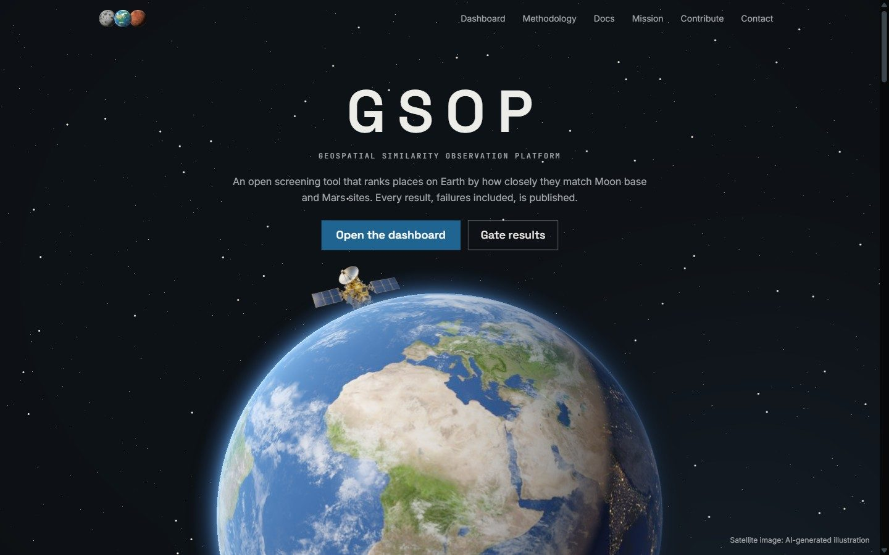
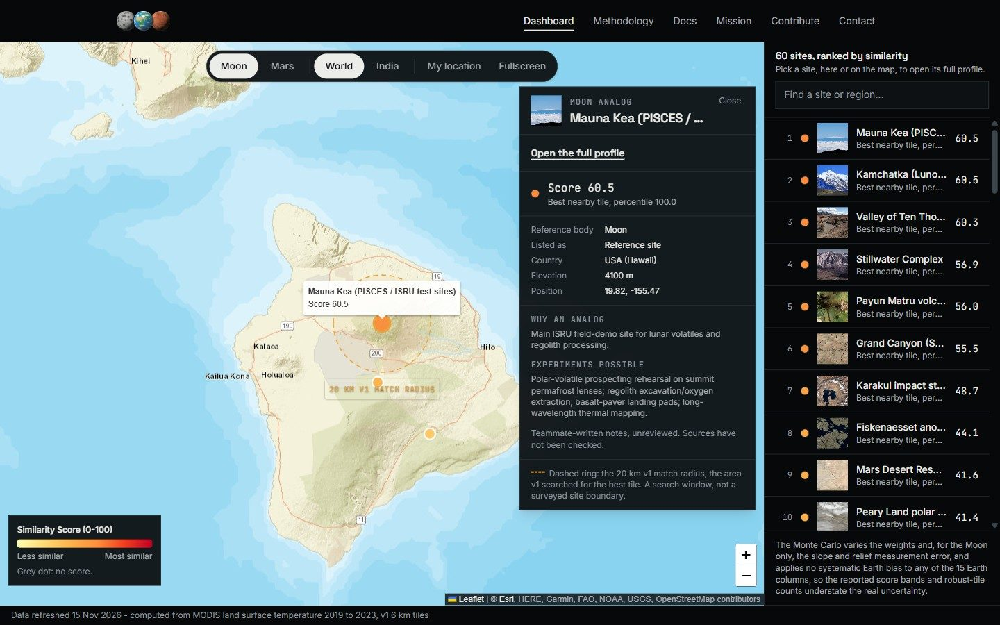
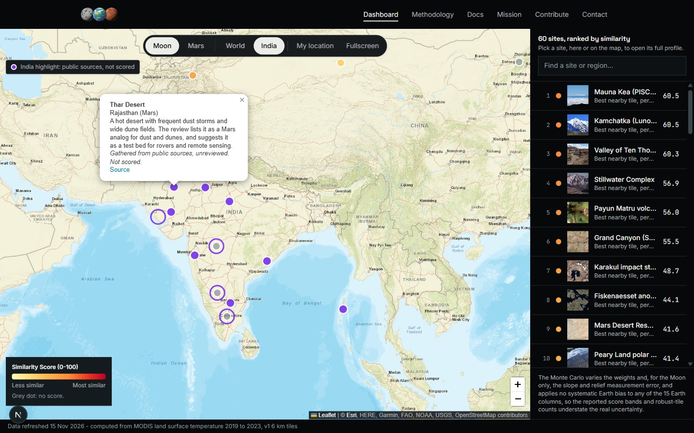
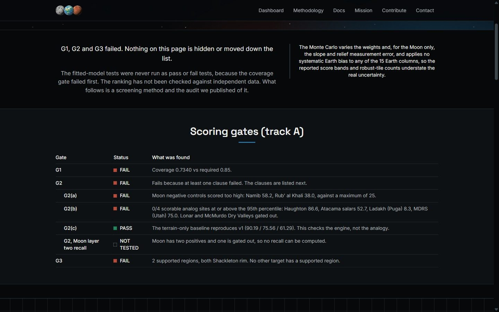
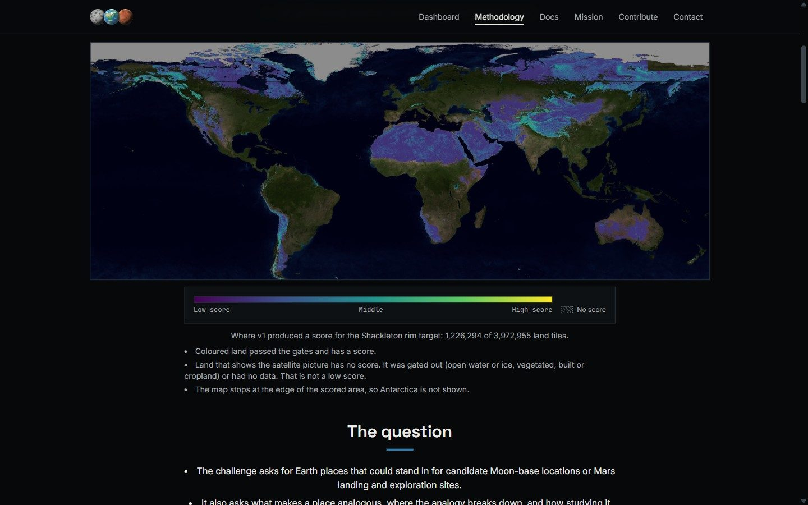
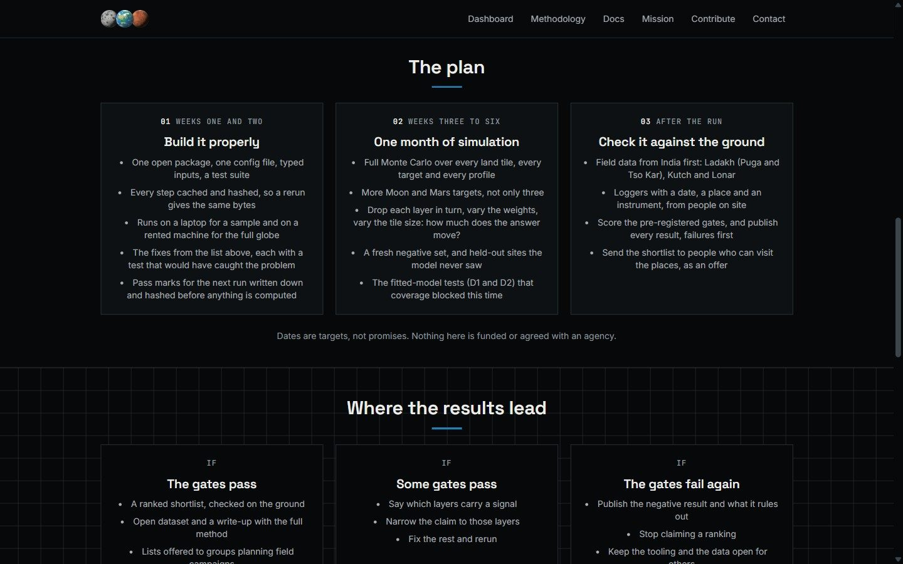

<div align="center">


<br><br>

<picture>
  <source media="(prefers-color-scheme: dark)" srcset="public/brand/logos/gsop-logo-horizontal-dark.svg">
  
</picture>

<br>

**An open screening tool that ranks places on Earth by how closely they match Moon base and Mars sites.**
<br>
Every result, failures included, is published.

<br>

[](https://github.com/AnayDhawan/GSOP/actions/workflows/ci.yml)
[](LICENSE)
[](https://gsoplatform.vercel.app)
[](https://www.spaceappschallenge.org)

[**Live site**](https://gsoplatform.vercel.app) · [Dashboard](https://gsoplatform.vercel.app/dashboard) · [Gate results](https://gsoplatform.vercel.app/gates) · [Methodology](https://gsoplatform.vercel.app/method) · [After the hackathon](https://gsoplatform.vercel.app/roadmap) · [Docs](https://gsoplatform.vercel.app/docs)

<br>



<!-- Demo GIF of the dashboard goes here: issue #102 -->

</div>

> Not affiliated with or endorsed by NASA. GSOP is a research prototype built independently for the NASA Space Apps Challenge 2026.

## Why GSOP?

Space agencies rehearse Moon and Mars work on Earth, at places called analogs. Analog lists lean on a few famous sites and rarely say where the analogy breaks. GSOP asks a narrower question and shows its work: which Earth places have terrain, and in v2 a thermal layer, like a Moon base or Mars target, using open data only.

- **Open.** Open data, open code, MIT licence. No login, no server-side queries: the data is static files.
- **Checkable.** Every number on the site has a row in a claims file that names its source file and hash.
- **Failures first.** The pass marks were written before the run. Failed gates are printed next to the results.
- **India first.** Indian field sites such as Ladakh sit beside the famous ones, and the site asks for ground measurements.
- **A screen, not a verdict.** The ranking tells you where to look first. It does not tell you a place is a good analog.

## Where we stand

The pre-registered gates, as published. Nothing here is hidden or reworded.

| Gate | What it checks | Status |
|---|---|---|
| G1 | Thermal coverage of land tiles | **FAIL** |
| G2 | Scoring: Moon controls and Mars positives | **FAIL** |
| G2(c) | The engine reproduces v1 (checks the engine, not the analogy) | **PASS** |
| G3 | Supported regions | **FAIL** |
| D1 | Fitted model, Moon | **NOT TESTED** |
| D2 | Fitted model, Mars | **NOT TESTED** |
| Moon recall | Moon positives found | **NOT TESTED** |

So today GSOP is a **screening aid, not a result**. Mars is a low-confidence secondary result, and the ranking has not been checked against independent data. One finding held up as a description, not a passed test: adding a MODIS land surface temperature layer cut Moon-side false positives. The reasons for each gate, and the limits, are on the [gates page](https://gsoplatform.vercel.app/gates). The plan to find out whether the idea works is on [After the hackathon](https://gsoplatform.vercel.app/roadmap).

## What is in it

| Page | What it does |
|---|---|
| [Dashboard](https://gsoplatform.vercel.app/dashboard) | Reference sites on a map and in a ranked list, Moon or Mars, World or India. Click a site for its card |
| [Gate results](https://gsoplatform.vercel.app/gates) | Every gate with its literal status, the numbers behind it, and six limitations |
| [Failure-First Ledger](https://gsoplatform.vercel.app/ledger) | What failed, and where each analogy breaks down |
| [Honest Map](https://gsoplatform.vercel.app/map) | Where v1 produced a score, on the NASA Blue Marble picture, with the failed controls in red |
| [Sites](https://gsoplatform.vercel.app/sites) | A card for each of the 120 sites, with photo credits and the stored score |
| [Methodology](https://gsoplatform.vercel.app/method) | How the screening works and the long list of things the score cannot see |
| [After the hackathon](https://gsoplatform.vercel.app/roadmap) | A proper build, a month of simulation, a check against ground data |
| [Docs](https://gsoplatform.vercel.app/docs) | For researchers, for organisations, and every static data file |

## Screenshots

<table>
  <tr>
    <td width="50%"><br><sub><b>Dashboard.</b> A site card with its score, honest status line and the 20 km v1 match radius.</sub></td>
    <td width="50%"><br><sub><b>India view.</b> One toggle zooms the map to India, where the ground data is thinnest.</sub></td>
  </tr>
  <tr>
    <td width="50%"><br><sub><b>Gate results.</b> Statuses are literal: PASS, FAIL or NOT TESTED.</sub></td>
    <td width="50%"><br><sub><b>Methodology map.</b> Colour only where v1 produced a score. The rest was gated out or had no data.</sub></td>
  </tr>
  <tr>
    <td colspan="2"><br><sub><b>After the hackathon.</b> The plan, the checks that decide it, and what each outcome would lead to.</sub></td>
  </tr>
</table>

## How it works

1. **Tile.** Earth's land is cut into equal-area tiles, 6 km on a side (EPSG:6933), so every tile counts the same.
2. **Score.** Each tile is compared with Moon targets (Shackleton rim, Connecting Ridge C1) and a Mars target (Jezero) on terrain and thermal layers, and ranked by percentile inside each body's own set. A Monte Carlo varies the weights.
3. **Gate.** Pass marks are fixed before the run. Every result is published, failures included.

## Quick start

Needs Node 24 or newer.

```bash
git clone https://github.com/AnayDhawan/GSOP.git
cd GSOP
npm install && npm run dev
```

Open http://localhost:3000. The site reads the committed files under `public/data/`, so nothing else needs to run.

### Scripts

| Command | What it does |
|---|---|
| `npm run dev` | Start the site in development |
| `npm run build` | Production build, every page prerendered as static HTML |
| `npm run lint` | ESLint |
| `npm test` | Vitest |
| `python3 scripts/check_claims.py` | Check every number against the claims file, and the wording rules. Standard library only |
| `python3 scripts/audit_site.py --base http://localhost:3100` | Crawl a running build and audit the wording, headings and standing statements |

### Rebuild the data

```bash
pip install -r scripts/requirements.txt
python3 scripts/make_data.py
python3 scripts/check_claims.py
```

`make_data.py` needs the v1 results zip, which is not committed. Without it, the committed files are the reference: `check_claims.py` verifies every claim against them, and all files in `data/MANIFEST.csv` match their recorded hashes. File layout, schemas and limits are in [docs/DATA_CONTRACT.md](docs/DATA_CONTRACT.md).

### Continuous integration

Every push and pull request runs the claims check, the Python tests, lint, the Vitest suite, a production build and the wording audit.

## Tech stack

| Area | Choice |
|---|---|
| Site | [Next.js](https://nextjs.org) 16 (App Router), [React](https://react.dev) 19, [TypeScript](https://www.typescriptlang.org) |
| Styling | [Tailwind CSS](https://tailwindcss.com) 4 with the GSOP brand tokens in `src/app/globals.css` |
| Maps | [Leaflet](https://leafletjs.com) and react-leaflet, Esri basemap tiles |
| Hero | One WebGL2 fragment shader, no library: Earth turning, a satellite on a tilted orbit |
| Tests | [Vitest](https://vitest.dev) and Testing Library, plus Python `unittest` for the data scripts |
| Data scripts | Python 3: numpy, pyarrow, pyproj, PyYAML, Pillow |
| Hosting | [Vercel](https://vercel.com). The deployed site never calls a database |
| Fonts | Space Grotesk, Inter and JetBrains Mono, self-hosted, SIL Open Font Licence |

## Folder structure

```text
GSOP/
├── src/app/                 pages (App Router), components and global styles
├── src/lib/                 data loaders, formatting and shared helpers
├── public/data/             static data files the site reads, and claims.csv
├── public/brand/            the GSOP brand pack: logos, fonts, patterns, OG image
├── data/                    reference data, MANIFEST.csv and the v2 run records
│   └── v2/runs/v2/          pre-registrations and results (hash-pinned, do not edit)
├── scripts/                 data build, claims check, wording audit and their tests
├── docs/                    data contract, site decisions, notes and README images
├── submission/              the Space Apps submission text, built from claims
└── CLAUDE.md                project rules for contributors and coding agents
```

## Data and credits

Every source, with what it contributed and its caveats, is on the [data sources](https://gsoplatform.vercel.app/data-sources) page.

| Source | Used for |
|---|---|
| NASA MODIS MOD11A2, MCD12Q1, MOD13A2 (LP DAAC, via Google Earth Engine) | Earth thermal layer, land cover, vegetation index |
| SRTM and Copernicus DEM | Earth slope, relief and roughness |
| LRO LOLA (NASA PGDA), Diviner (NASA PDS) | Lunar south pole terrain and thermal references |
| MGS MOLA (USGS Astrogeology), MGS TES (NASA PDS) | Mars terrain and thermal references |
| Natural Earth, OpenStreetMap contributors | India outline, region names, basemap |
| NASA Blue Marble | Picture under the score overlay on the map pages |
| Esri | Dashboard basemap tiles |
| [Solar System Scope](https://www.solarsystemscope.com/textures/) (CC BY 4.0) | Earth textures in the hero |

Photos on the site pages are open-licensed (CC0, public domain, CC BY or CC BY-SA), and each card prints its credit.

## Privacy

The site keeps only your theme choice, dark or light, in your own browser, and sends it nowhere. Two third parties are involved: Vercel Web Analytics counts page views and uses no cookies, and the dashboard loads map tiles from Esri, which sees the visitor's IP address and the part of the map in view. Details are on the [privacy page](https://gsoplatform.vercel.app/privacy).

## Roadmap

- **Now:** a published prototype with three failed gates, one passed and three not tested.
- **Next, weeks one and two:** build the simulation properly, with pass marks written and hashed before a run.
- **Then, one month:** full Monte Carlo over every tile, more targets, a fresh negative set, and the fitted-model tests coverage blocked.
- **After:** check it against ground data from India first, and publish every result.

Dates are targets, not promises. Nothing here is funded or agreed with an agency. The full plan, and what each outcome would lead to, is on [After the hackathon](https://gsoplatform.vercel.app/roadmap).

## Contributing

Ground measurements from analog sites, especially in India, and source corrections are the most useful contributions. Start with [CONTRIBUTING.md](CONTRIBUTING.md). Please read the [Code of Conduct](CODE_OF_CONDUCT.md), and report security problems through [SECURITY.md](SECURITY.md). The hard rules are short: no new simulation in the site repo, every number from a data file, statuses stay literal.

If this is useful, a star helps others find it.

## Team

- [Anay Dhawan](https://github.com/AnayDhawan)
- [Yash Kewlani](https://github.com/yakew7)
- Vihaan Bhagwat
- Shiven Sood
- Shaurya Jani
- Shaurya Gangrade

## Citing

GSOP team (2026). *GSOP: Geospatial Similarity Observation Platform, a screening index for Earth analog sites.* https://github.com/AnayDhawan/GSOP, commit `<hash>`. There is no DOI.

## Licence

MIT, 2026, the GSOP team. See [LICENSE](LICENSE). The fonts in `public/brand/fonts` keep their SIL Open Font Licence, and the licence texts sit beside them.
